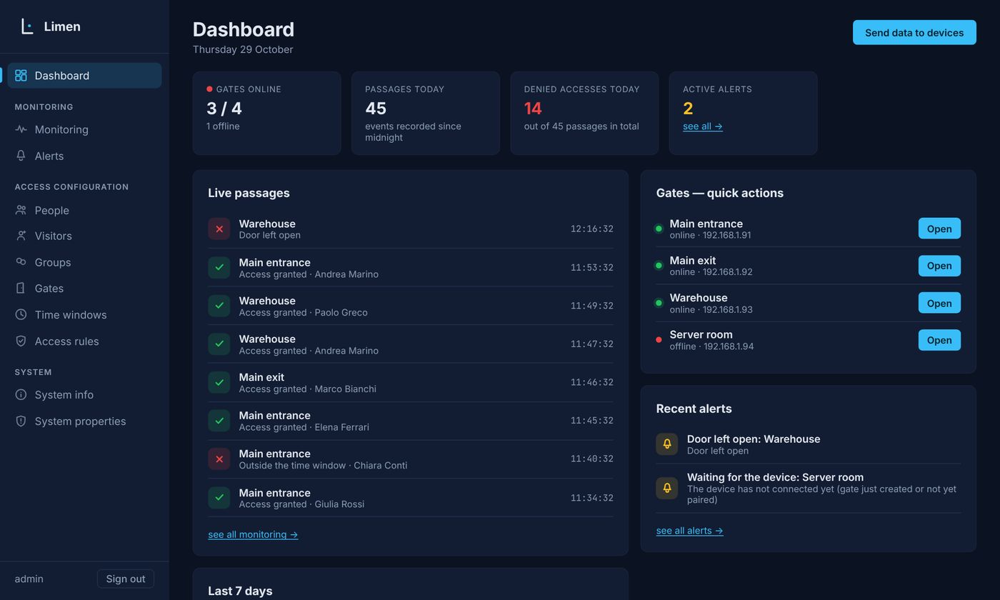
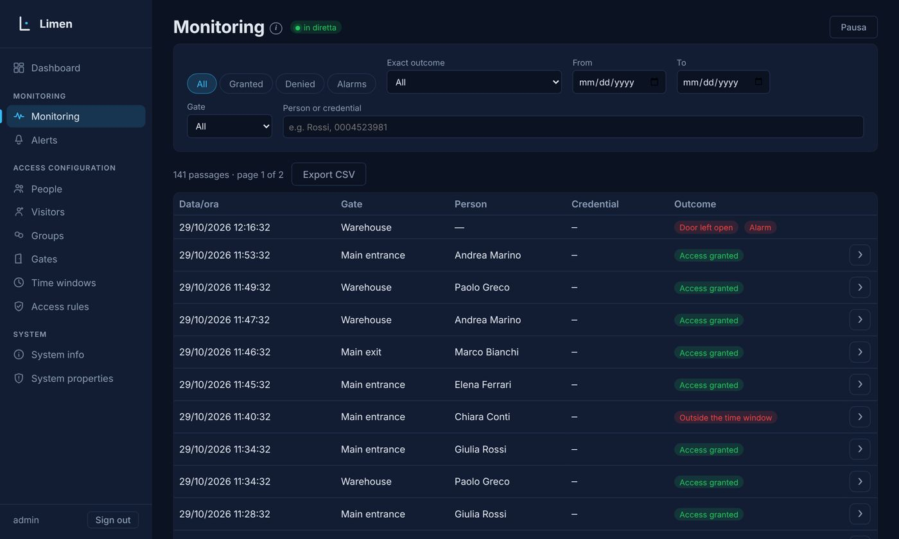
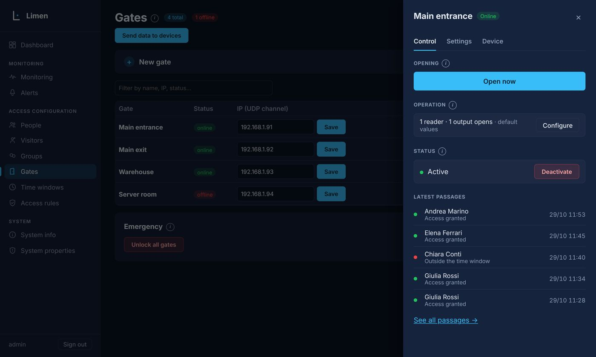
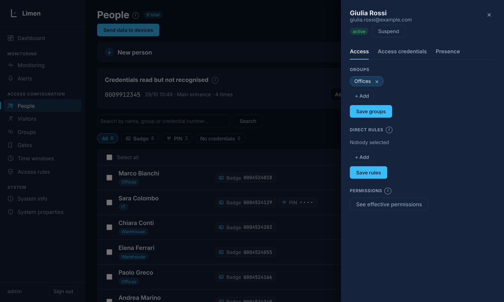

# Limen

[](LICENSE)  

**Open-source access control, built to make enterprise-grade door management easy, fast and accessible.**

Limen is a lightweight, self-hosted access control system. A web app (the *master*) manages people, credentials,
gates, time windows and access rules; small devices at the doors (the *slaves*, ESP32 boards) decide locally, in a few
milliseconds, even when the master or the network is down. No cloud, no subscription, no vendor lock-in: one container
on any machine you already have.

> **Status:** early stage, under active development. The master (web app, protocol, API) is feature-complete for
> daily use and covered by an automated test suite run during development. The ESP32 firmware logic is tested against the
> real master on a PC; **testing on real boards is still in progress**. Evaluate it on a bench before trusting it with a real
> door, and never rely on it as your only means of emergency egress.

## Screenshots

| | |
|---|---|
|  |  |
|  |  |

## Highlights

- **Local decisions.** Each gate keeps a cache of the credentials allowed on it and decides on the spot. Remote opening is
  a command from the master, never a permission request to the master.
- **Simple, signed protocol.** Master and slaves talk only UDP (port 57990), unicast, with HMAC-SHA256-signed packets,
  replay-window checks, delivery acknowledgements and a persistent event queue on the device, so a switched-off master
  or a lost packet never loses an access event.
- **A complete web app.** People, groups, visitors with an expiry, badges, PINs and other credentials, access rules,
  time windows with holidays, live monitoring, alerts, anti-passback, "who is inside now", CSV import/export,
  an explained reason for every denied access, system health, backup and a detailed diagnostic log.
- **Per-gate behaviour.** Readers, outputs (door strike, siren, alarm arming) and inputs (door sensor, button, remote) are
  configured from the web app; modes: normal, scheduled unlock, maintenance, emergency.
- **Public REST API** with token authentication, and PDF documentation (see `api/`).
- **HTTPS everywhere** (self-signed certificate generated on first start, or bring your own).
- **Italian and English** web interface; each user picks their own language.
- **Runs anywhere.** Linux server, mini PC, Raspberry Pi, a VM, Docker. SQLite, no external services. The web app loads nothing
  from the internet.

## How it works

```
  browser ──HTTPS──►  MASTER (FastAPI + SQLite)  ◄──UDP 57990, signed──►  SLAVE (ESP32 at the door)
                       people · rules · log · API                          cache · local decision · relays · inputs
```

The master builds, for each gate, a compact cache of the credentials that have a valid rule on it, and sends it to the device.
The device checks every badge against that cache and its clock, opens the relay, and reports the event afterwards.
Device IPs are fixed and written only on the master, which contacts each device first; devices never broadcast.
Details: [`docs/FEATURES.md`](docs/FEATURES.md) (features and protocol) and [`docs/ARCHITECTURE.md`](docs/ARCHITECTURE.md).

## Quick start (Docker, Linux)

```bash
git clone https://github.com/isidorzabiku-pixel/Limen-Access-Control.git && cd Limen-Access-Control
docker compose up -d --build
```

Open **https://&lt;server-ip&gt;:8443** (your browser warns once about the self-signed certificate) and sign in with
**admin / admin**. The app shows a warning until you change that password in *System properties*.

The compose file uses host networking so the master reaches your devices with the server's real address. Database,
certificates and the session key live in the `limen-data` volume and survive updates
(`git pull && docker compose up -d --build`). More in [`docs/DEVELOPMENT.md`](docs/DEVELOPMENT.md).

**Without Docker:** `cd backend && python3 -m venv venv && . venv/bin/activate && pip install -r requirements.txt && ./avvia.sh`
(a systemd unit is in `deploy/limen.service`).
**Windows / macOS:** run natively with Python (Docker Desktop's host networking is not reliable for UDP); a packaged installer is planned.

### First steps

1. *Gates* → create a gate (name, number, device IP).
2. Flash the ESP32 (below), give it the same gate number and a fixed IP; when it appears on the *Gates* page press **Pair**.
3. *People* → add a person and a badge. *Access rules* → connect the person (or a group) to the gate with a time window.
4. Press **Send data** to push the first cache to the devices (it is also sent automatically every 6 hours).

## Slaves (devices at the door)

- **ESP32 firmware** — [`firmware/esp32/`](firmware/esp32/README.md). C++ core with no Arduino dependency (decision, cache,
  protocol, HMAC-SHA256) plus the ESP32 platform layer. Test console on the device web page while no reader driver is
  attached. Two hardware variants share one core: a board with an RS-485 reader, and an all-in-one PoE reader. The device
  interface is English-only.
- **Python agent (test version)** — [`agent/`](agent/INSTALL_PI.md). A Raspberry Pi implementation used to try the protocol and
  GPIO wiring. It is **not maintained** and not the supported slave.

## Security notes

Limen is meant for a closed network: keep devices on a dedicated VLAN and do not expose port 8443 to the internet.
Change the default password at first login. The pairing key travels once, in clear text, on the LAN when you press **Pair**.
Report vulnerabilities privately to the maintainer before disclosing them.

## Documentation

| | |
|---|---|
| [`docs/FEATURES.md`](docs/FEATURES.md) | Every feature of the web app and the full UDP protocol |
| [`docs/ARCHITECTURE.md`](docs/ARCHITECTURE.md) | Code map, cache, permissions, anti-passback |
| [`docs/DEVELOPMENT.md`](docs/DEVELOPMENT.md) | Git workflow, running, testing, releasing, Docker |
| [`api/`](api/README.md) | REST API documentation (PDF) |

## Credits

Limen is created and maintained by **Isidor Zabiku**, who owns the project and sets its direction.

Most of the code was written with the help of **Claude** (Anthropic's AI model), the largest contributor to this repository.

Copyright © 2026 Isidor Zabiku. Licensed under the AGPL-3.0 (see below).

## License

Limen is free software under the **GNU Affero General Public License v3.0** (`AGPL-3.0-only`, see [`LICENSE`](LICENSE)):
you can use, study, modify and share it, and if you distribute it or run a modified version as a network service you must
make your source available under the same license.

**Commercial license.** If the AGPL does not fit your use (for example you want to embed Limen in a closed-source
product), a separate commercial license is available from the maintainer.

The name "Limen" and its logo are not covered by the AGPL: the license grants rights on the code, not on the brand.

Contributions are welcome: see [`CONTRIBUTING.md`](CONTRIBUTING.md) and the [`CLA`](CLA.md). Third-party components and their licenses:
[`THIRD_PARTY_NOTICES.md`](THIRD_PARTY_NOTICES.md).
