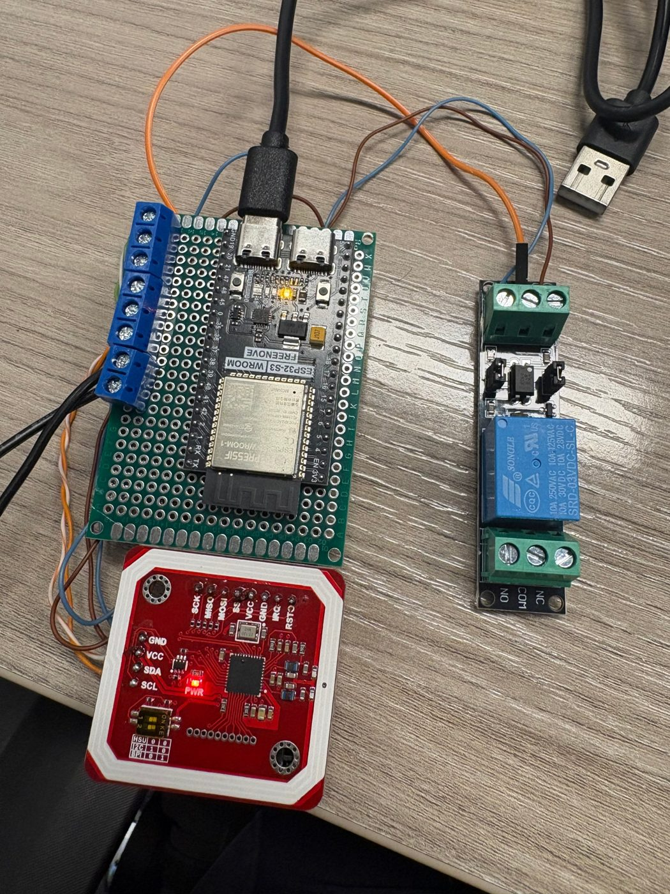
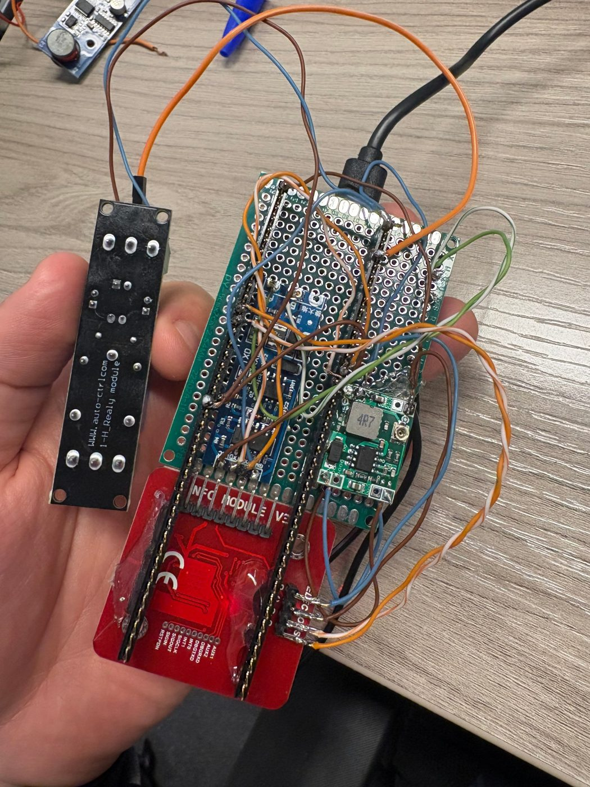
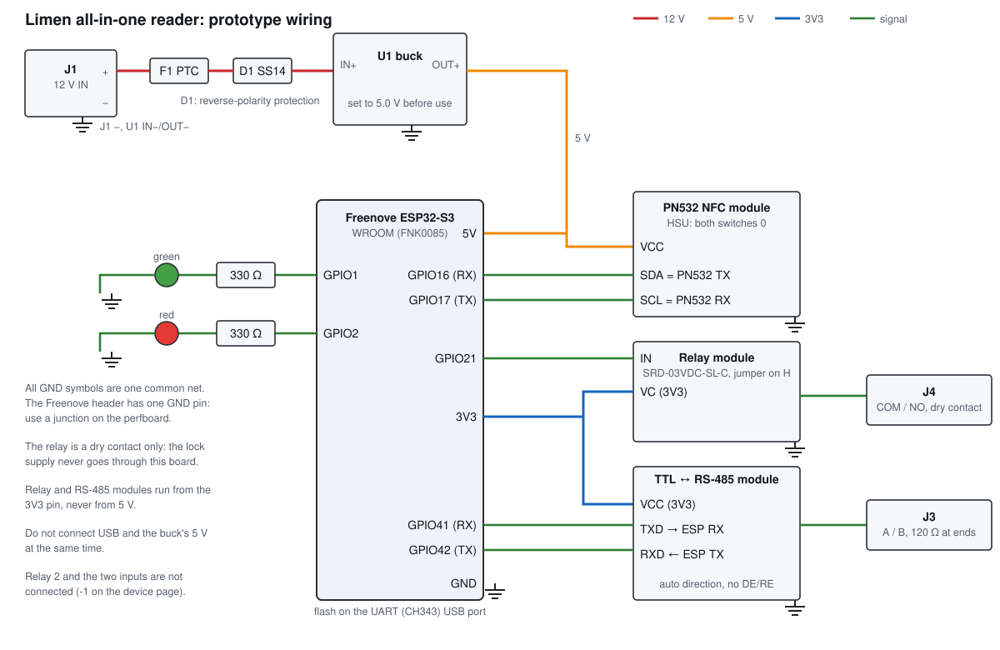

# All-in-one reader: how the prototype was built

One small board that is **reader and slave at the same time**: it reads MIFARE badges, DESFire cards and phones (BLE and
NFC), decides locally from the cache received from the master, and opens the door with a dry-contact relay. It runs the
standard Limen firmware (`pio run -e esp32s3`, see [`firmware/esp32/README.md`](../../firmware/esp32/README.md)); only the
pin settings are specific to this build. It was built and tested on the bench from off-the-shelf modules on a perfboard.

| Front | Back |
|---|---|
|  |  |

## Parts

| Part | Used for |
|---|---|
| Freenove ESP32-S3 WROOM board (FNK0085, 8 MB flash) | the slave: Wi-Fi, BLE, cache, decisions |
| PN532 NFC module (red V3 board), HSU mode | MIFARE UID, DESFire, phones over NFC |
| Mini DC-DC buck converter (MP1584EN type, adjustable) | 12 V in → 5 V for the board and the PN532 |
| 1-channel optocoupler relay module, SRD-03VDC-SL-C (3 V coil) | opens the door: dry contact only |
| TTL ↔ RS-485 module with automatic direction (no DE/RE pin) | wired for the future reader head, no firmware driver yet |
| Green and red LED, 2 × 330 Ω | granted / denied (the red LED stays on 2 s after a denial) |
| PTC fuse, Schottky diode (SS14 or 1N5819) | protection on the 12 V input |
| 3 × 2-pole 5.08 mm screw terminals | J1 12 V in, J3 RS-485 A/B, J4 relay COM/NO |
| Perfboard, hook-up wire | assembly |

## Wiring

| Signal | From | To |
|---|---|---|
| PN532 data | PN532 SDA (its TX) | GPIO16 (ESP32 RX) |
| PN532 data | PN532 SCL (its RX) | GPIO17 (ESP32 TX) |
| Relay | GPIO21 | relay module IN |
| Green LED | GPIO1 | 330 Ω → LED → GND |
| Red LED | GPIO2 | 330 Ω → LED → GND |
| RS-485 (wired only) | GPIO42 (TX) / GPIO41 (RX) | module RXD / TXD |

The PN532 is used in **HSU** (serial) mode: both switches on the module set to 0, header pins GND, VCC, SDA, SCL.

## Power

12 V → J1 → PTC fuse → Schottky diode (reverse-polarity protection) → buck converter → **5.0 V** → the board's `5V` pin
and the PN532 VCC. Set the buck output to 5.0 V with a meter **before** connecting anything to it.

The relay module and the RS-485 module run from the board's **3V3** pin (the relay's 3 V coil needs about 100–120 mA). All
grounds are one common net: the Freenove header has a single GND pin, so use a junction on the perfboard.

- **Do not connect USB and the buck's 5 V at the same time.** Whether the board has a diode between its USB port and the
  `5V` pin is not verified. To flash, switch the 12 V off and use the **UART (CH343)** USB port.
- The relay is a **dry contact** (COM/NO). The lock supply, and any flyback diode, belong to the lock's own power supply:
  they never go through this board. Set the relay module's trigger jumper to **H** (active high).
- The RS-485 module needs a 120 Ω terminator only at the two ends of a bus.

## Pin settings

The default pins in the firmware are not the ones used here. Either enter them on the device page (Pins), or copy
[`firmware/esp32/data/config.txt.prototipo`](../../firmware/esp32/data/config.txt.prototipo) to `config.txt` and upload
it as described in the firmware README.

| Setting | Value |
|---|---|
| Relay 1 | 21 (active high) |
| Relay 2, inputs 1 and 2 | -1 (not connected) |
| Green LED / red LED | 1 / 2 |

Avoid GPIO 0, 3, 45, 46 (boot), 35–37 (PSRAM), 19/20 (USB) and 43/44 (console) for your own wiring on this board.

## Status

Tested on the bench: reading badges, DESFire cards and phones (BLE and NFC), relay and LEDs, pairing with the master and
opening from the dashboard. Not done yet: the RS-485 driver and the reader-only build, an input for a door sensor or
button (a dry contact with a series resistor, a pull-up, a small capacitor and a TVS diode is the planned circuit), and
a buzzer.
